<!--
  README.md is GENERATED by `npm run build` from this file + profile.config.json.
  Edit THIS file for layout/wording, and profile.config.json for content.
  Placeholders are upper-case words in double curly braces: NAME, USER, TITLE, BADGES, PROJECTS, CONTACT.
-->

  {{BADGES}}

 

 

### `$ npx playwright test --project=all`

 

### `$ npx playwright show-trace trace.zip`

 

### `$ ./pipeline --run`

 

### `$ jira board --mine`

 

### `$ ls -la ~/projects`

| repo | what it does | stack |
| :--- | :----------- | :---- |
{{PROJECTS}}

More on [github.com/{{USER}}?tab=repositories](https://github.com/{{USER}}?tab=repositories)

 

### `$ gh profile stats`

 

### `$ ./contribution-snake`

<picture>
  <source media="(prefers-color-scheme: dark)" srcset="https://raw.githubusercontent.com/{{USER}}/{{USER}}/output/github-snake-dark.svg"/>
  <source media="(prefers-color-scheme: light)" srcset="https://raw.githubusercontent.com/{{USER}}/{{USER}}/output/github-snake.svg"/>
  
</picture>

 

### `$ echo $CONTACT`

  {{CONTACT}}

 

